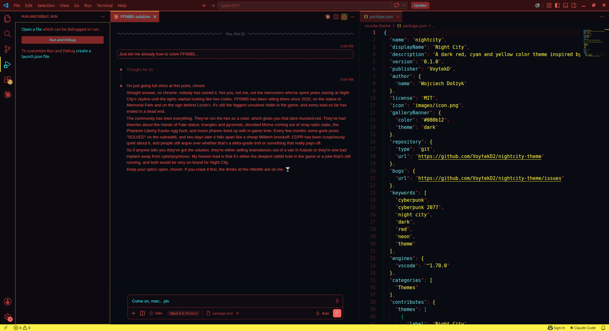

# Night City Journal

A dark color theme for VS Code inspired by the in-game journal screen of **Cyberpunk 2077**: deep navy-black background, red interface text, cyan highlights and the signature yellow accent.



## Palette

Every color was sampled from the journal screen and then tuned for readability in code.

| Color | Hex | In the game | In the editor |
|---|---|---|---|
| Background | `#080b12` | Journal backdrop | Editor, terminal |
| Red | `#ff5f56` | Header lines, section titles | Keywords, tags, borders |
| Soft red | `#ec6458` | Quest descriptions | Default text, variables |
| Cyan | `#5ef6ff` | Quest names, level | Functions, selected items, attributes |
| Yellow | `#fcee0a` | The Cyberpunk accent | Strings, status bar, active borders, cursor |
| Green | `#1db866` | "Danger: low", street cred | Types, classes, CSS selectors |
| Magenta | `#e05aa0` | Faction icon | Numbers, constants |
| Teal | `#50949d` | Dimmed UI frames | Comments |
| Maroon | `#7c2626` | Selected quest row | Selection, active tab |

## Install

1. Open the Extensions view (`Ctrl+Shift+X`).
2. Search for **Night City Journal** and install it.
3. Press `Ctrl+K Ctrl+T` and choose **Night City Journal**.

## Recommended font

The screenshot uses [Share Tech Mono](https://fonts.google.com/specimen/Share+Tech+Mono), a free monospaced font with the same squared, technical shapes as the game's interface. Install it, then add this to your `settings.json`:

```json
"editor.fontFamily": "'Share Tech Mono', monospace",
"editor.fontSize": 15,
"editor.lineHeight": 1.5,
"terminal.integrated.fontFamily": "'Share Tech Mono', monospace"
```

## Disclaimer

Night City Journal is an unofficial fan-made theme. It is not affiliated with, endorsed by or connected to CD PROJEKT RED. Cyberpunk 2077 is a trademark of CD PROJEKT S.A.

## License

[MIT](LICENSE)
